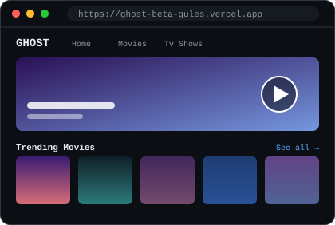
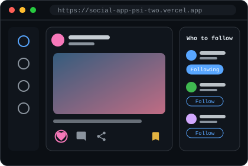

<p align="center">
  
</p>

<p align="center">
  <a href="https://www.linkedin.com/in/borhan-mahmoud"><b>LinkedIn</b></a> &nbsp;·&nbsp;
  <a href="mailto:borhanmahmoud200@gmail.com"><b>borhanmahmoud200@gmail.com</b></a> &nbsp;·&nbsp;
</p>

---

## `git log --graph` &nbsp;·&nbsp; my journey so far

<p align="center">
  
</p>

## `const borhan` &nbsp;·&nbsp; about me

```jsx
const Borhan = () => (
  <Developer
    name="Borhan Mahmoud"
    role="Front-End Developer"
    focus={["React", "Next.js", "TypeScript"]}
    experience="Junior Front-End Developer @ DevTik (software house, full-time)"
    education="Front-End Development Diploma @ Route Academy"
    currently="exploring new technologies for front-end development"
    askMeAbout="Front-End Development"
    openToWork
  />
);
```

## `package.json` &nbsp;·&nbsp; my stack

<p align="center">
  
</p>

<details>
<summary><b>Prefer plain text?</b></summary>

- **Languages:** HTML5, CSS3, JavaScript (ES6+), TypeScript
- **Frameworks & libraries:** React, Next.js, Redux, Tailwind CSS, Bootstrap, Sass
- **Tools & deployment:** Git, GitHub, Vercel, hosting & domain setup
- **Concepts:** Responsive Web Design, REST APIs, Asynchronous Programming, State Management, Cross-Browser Compatibility, Component-Based Architecture, Agile

</details>

## `git push` &nbsp;·&nbsp; featured projects

<table>
<tr>
<td width="50%" valign="top">
<a href="https://ghost-beta-gules.vercel.app/"></a>
<h3>🎬 GHOST</h3>
<p>Movie &amp; TV streaming platform with Home, Movies and TV Shows pages, trending, popular and latest-release sections, and a <b>real video player</b> so titles are ready to watch. Data from the TMDB API, images optimized with the Next.js Image component.</p>
<p><code>Next.js</code> <code>React</code> <code>TMDB API</code> <code>Vercel</code></p>
<p><a href="https://ghost-beta-gules.vercel.app/"><b>Live demo →</b></a></p>
</td>
<td width="50%" valign="top">
<a href="https://social-app-psi-two.vercel.app/"></a>
<h3>💬 Social Media App</h3>
<p>Social platform where you can <b>post, comment, like, share, follow and save posts</b>. State managed with Redux, async data handled through REST APIs.</p>
<p><code>React</code> <code>Redux</code> <code>REST API</code> <code>Vercel</code></p>
<p><a href="https://social-app-psi-two.vercel.app/"><b>Live demo →</b></a></p>
</td>
</tr>
</table>

## `git blame` &nbsp;·&nbsp; experience

**Junior Front-End Developer** · DevTik (software house, full-time) · *Aug 2024 – Nov 2024*

<details>
<summary><b>What I did there</b></summary>

- Built responsive pages from UI/UX designs using HTML5, CSS3, Bootstrap and Tailwind CSS
- Developed reusable, component-based features with React and Next.js, using TypeScript for type safety
- Integrated RESTful APIs and handled async data fetching with Promises and async/await
- Worked with Git and GitHub: feature branching, pull requests and code reviews
- Fixed cross-browser and responsive layout issues for a consistent UI across devices
- Collaborated with designers, back-end developers and QA in an agile team

</details>

**Education:** Front-End Development Diploma, Route Academy (2024) · Bachelor's Degree, Faculty of Arts, Alexandria University (2024)

---

<p align="center"><b>Let's build something together.</b></p>

```bash
$ git commit -m "open to Front-End Developer opportunities"
$ git push origin main   # borhanmahmoud200@gmail.com
```
